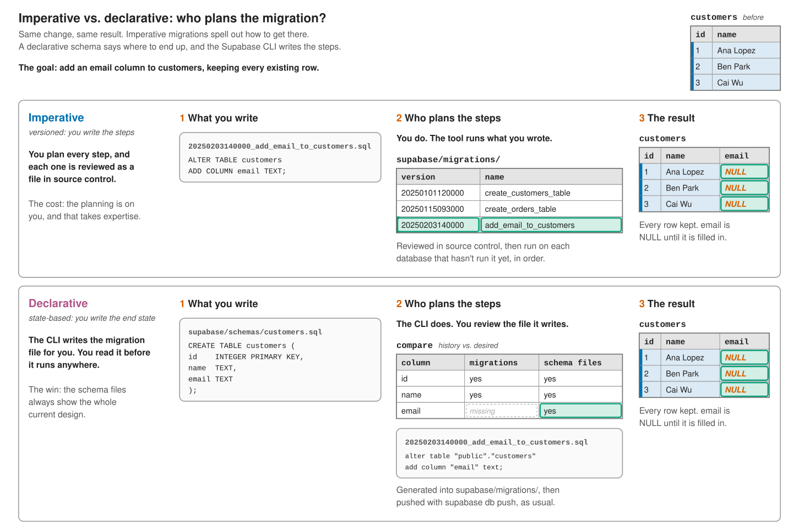

## Learning Objectives

By the end of this chapter, students will be able to:

- **Distinguish** between imperative (versioned) and declarative (state-based) approaches to changing a database schema.
- **Explain** how a declarative tool turns a desired schema into a migration by comparing it against a current schema.
- **Use** Supabase's declarative schemas to generate a migration file from a schema file.
- **Review** a generated migration for changes that could fail or lose data, and for changes a schema diff cannot capture.
- **Evaluate** which approach fits a given change.

You already know one declarative language well. A SQL query describes the result you want, not the steps for getting it: you write `SELECT ... WHERE ... GROUP BY`, and the query planner decides which indexes to use, which table to scan first, and how to join them. You describe the destination. The database works out the route.

The migrations in the previous chapter work the other way around. Each migration file is a list of instructions: create this table, add this column, rename that one. You describe the route, step by step, and the database follows it exactly. This is the **imperative** approach to schema change, also called **versioned** or change-based migrations, and it is the one this book uses.

There is a second approach. In a **declarative** (or **state-based**) workflow, you do not write the steps. You keep files that describe what the schema should look like right now, and a tool compares them against the current schema and works out the steps for you. Supabase supports both approaches, so it is worth understanding how they differ and when each one fits.

## Two Ways to Describe a Change

Take the change from the previous chapter: the `customers` table needs an `email` column.

### Imperative: write the steps

In an imperative workflow, you write a migration file that says exactly what to do:

```sql
-- supabase/migrations/20250203140000_add_email_to_customers.sql
ALTER TABLE customers
    ADD COLUMN email TEXT;
```

The file is reviewed in source control like any other code. The migration tool runs every file a database has not run yet, in timestamp order, and records each one in its tracking table. It does not reinterpret your SQL. It runs what you wrote.

The source of truth is the **history**: the full, ordered sequence of migration files. To learn what the schema looks like today, you replay every file from an empty database, or you inspect a database that has already run them.

### Declarative: write the end state

In a declarative workflow, you edit a schema file so that it describes the table as it should look after the change:

```sql
-- supabase/schemas/customers.sql
CREATE TABLE customers (
    id    INTEGER PRIMARY KEY,
    name  TEXT,
    email TEXT
);
```

There is no `ALTER` statement anywhere in this file. It reads like the very first `CREATE TABLE` script you ever wrote, except it is kept up to date. A declarative tool compares the desired schema in the file against the current one, finds the differences (here, one missing column), and works out the statements that close the gap: `ALTER TABLE customers ADD COLUMN email TEXT`.

The source of truth is the **schema files**. Anyone who wants to know what the `customers` table looks like can open one file and read it, with no history to replay.

Declarative tools differ in two ways: what they compare against (a live database, or the schema an existing migration history produces) and what they do with the result (apply it directly, or save it for review). Supabase's version compares against your migration history and saves the result as an ordinary migration file. Both workflows end in the same place:

{fig-alt="The same change described two ways: add an email column to the customers table, which already has three rows: Ana Lopez, Ben Park, and Cai Wu. Imperative (versioned): you plan the steps yourself and write them in a new migration file, 20250203140000_add_email_to_customers, containing ALTER TABLE customers ADD COLUMN email TEXT. The file is reviewed in source control, and the tool runs every file the database has not run yet, in timestamp order, exactly as written. Declarative (state-based), with Supabase's declarative schemas: you edit supabase/schemas/customers.sql so that CREATE TABLE customers lists id, name, and email. The Supabase CLI compares the schema files with the schema your existing migrations produce, finds that email exists only in the schema files, and writes the difference to a new migration file in supabase/migrations/: alter table public.customers add column email text. You review the generated file, then push it with supabase db push, as usual. Both end the same way: customers gains an email column, NULL for the three existing customers, and every existing row is kept. The difference is what you write and who plans the steps." width="75%"}

The difference is not the result. It is what you write and who does the planning.

## Declarative Schemas in Supabase

Supabase calls this feature [declarative database schemas](https://supabase.com/docs/guides/local-development/declarative-database-schemas). You describe the schema in SQL files under `supabase/schemas/`, and the Supabase CLI writes the migrations for you [@supabase_declarative_schemas].

::: {.callout-note}
The commands in this section use Supabase's `pg-delta` diff engine, which is marked experimental. Turn it on in `supabase/config.toml`:

```toml
[experimental.pgdelta]
enabled = true
```

Without it, the CLI falls back to an older engine, `migra`, which generates migrations with `supabase db diff -f <name>` instead and supports fewer kinds of database objects. Because the feature is still changing, check the Supabase documentation for the current commands before you rely on them.
:::

### The workflow

1. **Edit the schema files.** Add the `email` column to `supabase/schemas/customers.sql`, as shown above. To keep the generated changes predictable, Supabase recommends adding new columns at the end of a table definition.

2. **Generate a migration.**

   ```bash
   supabase db schema declarative sync -f add_email_to_customers --no-apply
   ```

   The CLI compares the schema files with the schema your existing migrations produce, and writes the difference to a new, timestamped file in `supabase/migrations/`. The `-f` flag names the file. The `--no-apply` flag writes the file without applying it. Without that flag, the CLI offers to apply the migration to your local database right away.

3. **Review the generated file.** Open it and read it the same way you would read a teammate's migration. The next section covers what to look for.

4. **Apply and deploy.** Apply the migration to your local database with `supabase migration up`. Then commit it, and push it to the remote database with `supabase db push`.

From step 4 on, nothing is new. The generated file is an ordinary migration. It gets a timestamp, it is recorded in the remote tracking table when it runs, and it is pushed to a test database before production, exactly like the files you wrote by hand in the previous chapter. Supabase's declarative schemas change how migrations are *written*, not how they are *delivered*.

### Rolling back

The forward-only rule from the previous chapter still applies. If a generated migration has not been deployed anywhere yet, you can reset your local database to the version before it with `supabase db reset --version <timestamp>`, fix the schema files, and generate the migration again. Once a migration has reached production, do not reset or edit it. Instead, revert the change in the schema files and generate a new migration that undoes it.

## Reviewing the Generated Migration

The CLI writes the steps, but it does not know what data is in your tables or what you meant by a change. Reading the generated file is your job.

### Changes that fail on a table with rows

The Supabase documentation's own example adds an `age` column to an `employees` schema file:

```sql
-- supabase/schemas/employees.sql
create table "employees" (
  "id" integer not null,
  "name" text,
  "age" smallint not null
);
```

The generated migration is a single statement:

```sql
alter table "public"."employees" add column "age" smallint not null;
```

That migration is correct for the schema, and it runs fine on an empty table. On a table that already has rows, PostgreSQL rejects it, because every existing employee would have a `NULL` age in a column that forbids `NULL`. The fix is the add, backfill, require pattern: add the column as nullable, fill it in with an `UPDATE`, then add `NOT NULL`. A schema diff will not write the `UPDATE` for you, so you edit the generated file (or write that migration by hand).

### Changes that lose data

Removing a column from a schema file produces a migration that drops the column, and every value stored in it goes with it. The same is true of removing a table. Generated migrations deserve the same scrutiny as hand-written ones: read every `DROP` and ask whether the data it removes is still needed.

### Changes the diff cannot see

Some things never appear in a generated migration:

- **Data changes.** In the Supabase documentation's words, "DML statements such as `insert`, `update`, and `delete` are never captured by a schema diff." A change that moves data, like splitting a column out into its own table, still needs a hand-written migration for the part that moves the rows.
- **Changes made outside the schema files.** A column added through the Supabase dashboard or the SQL editor is invisible to the diff. Make every schema change in the schema files, or the files and the database will drift apart.
- **Objects the engine does not track.** Some less common kinds of database objects are not modeled by the diff engine, and objects in Supabase-managed schemas such as `auth` and `storage` are excluded. The CLI reports untracked objects as warnings. Changes to them go in versioned migrations.

## Choosing an Approach

| | Imperative (versioned) | Declarative (state-based) |
|:--|:--|:--|
| You write | The steps (`ALTER TABLE ...`) | The end state (`CREATE TABLE ...`) |
| Who plans the steps | You | The tool, by comparing desired against current |
| Source of truth | The ordered migration history | The schema files |
| Reading the current schema | Replay the history, or inspect a database | Open the schema files |
| What reaches production (in Supabase) | Your migration files | Generated migration files, after review |
| Data changes | Written in the migration | Not captured; written by hand |

In Supabase the two approaches are not mutually exclusive. Both produce files in `supabase/migrations/`, and both are delivered with `supabase db push`. A practical way to use them together is to let the schema files generate the purely structural changes (new tables, new nullable columns, new indexes) and to write migrations by hand, or edit generated ones, whenever existing data has to be filled in or moved.

This book writes migrations by hand so that every step is visible. That habit carries over to declarative schemas. Whether you write the steps yourself or review the ones the CLI wrote for you, you should be able to read a migration and predict what it will do to the data already in the database.

## Exercises {.unnumbered}

### Reflection {.unnumbered}

1. SQL queries are declarative, and so are schema files. A query planner can pick any plan it likes without asking you. Why does a generated migration need a person to review it before it runs on production?

2. Supabase's `sync` command compares the schema files with the schema your migration history produces, not with the live database. What is one advantage of comparing against the history? What could it miss?

3. A colleague adds an index to production through the Supabase dashboard, but nobody updates the schema files. Will the next generated migration mention the index? What happens when a new teammate builds a fresh database from the migration files?

4. A teammate removes a column they think is unused from a schema file, generates a migration, and pushes it. What should the review in step 3 have checked first?

### Coding {.unnumbered}

5. Write the schema file for `customers` after adding a `phone` column (text, nullable). Then write the migration you expect `supabase db schema declarative sync` to generate. Could it fail on a table with rows?

6. Rewrite the Supabase documentation's `age` example so that it succeeds on an `employees` table that already has rows, giving every existing employee an age of `0` until the real values are filled in. Which of your statements would a schema diff never generate, and why?

7. `customers` stores each customer's city as free text in a `city` column. Write the schema files after moving cities into their own `cities` table, with `customers.city_id` as a `NOT NULL` foreign key. Then write the migration that makes the change on a table that already has rows, keeping every customer's city. Mark the statements you would have to write by hand.
